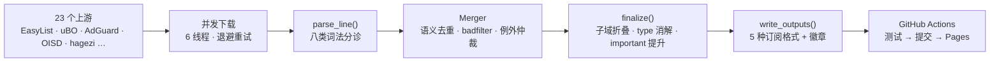

<div align="center">


# LJGZ · 广告过滤规则聚合

**23 个上游每日聚合 · 语义级去重 · 一份订阅覆盖全场景**


<br/>


**🌐 [在线订阅中心](https://wansheng8.github.io/LJGZ/)** — 点开即复制，无需读文档

</div>

---

## 订阅

| 场景 | 首选 (GitHub Pages) | 备选 (jsDelivr / CDN) | 备用 (raw) |
|---|---|---|---|
| 🧩 **浏览器扩展**<br><sub>uBlock Origin · AdGuard · Adblock Plus</sub> | [**all.txt**](https://wansheng8.github.io/LJGZ/all.txt)<br><sub>完整版 · 约 28MB</sub><br><sub>分卷：[1](https://wansheng8.github.io/LJGZ/all-part-01.txt) + [2](https://wansheng8.github.io/LJGZ/all-part-02.txt)</sub> | [all.txt](https://cdn.statically.io/gh/wansheng8/LJGZ/main/output/all.txt) | [all.txt](https://raw.githubusercontent.com/wansheng8/LJGZ/main/output/all.txt) |
| 🏠 **AdGuard Home**<br><sub>AdGuard Home · AdGuard DNS</sub> | [adguard.txt](https://wansheng8.github.io/LJGZ/adguard.txt) | [adguard.txt](https://cdn.jsdelivr.net/gh/wansheng8/LJGZ@main/output/adguard.txt) | [adguard.txt](https://raw.githubusercontent.com/wansheng8/LJGZ/main/output/adguard.txt) |
| 🕳 **Pi-hole / hosts**<br><sub>Pi-hole · SwitchHosts · 路由器</sub> | [hosts.txt](https://wansheng8.github.io/LJGZ/hosts.txt) | [hosts.txt](https://cdn.jsdelivr.net/gh/wansheng8/LJGZ@main/output/hosts.txt) | [hosts.txt](https://raw.githubusercontent.com/wansheng8/LJGZ/main/output/hosts.txt) |
| 📃 **纯域名列表**<br><sub>Cloudflare Gateway · NextDNS</sub> | [domains.txt](https://wansheng8.github.io/LJGZ/domains.txt) | [domains.txt](https://cdn.jsdelivr.net/gh/wansheng8/LJGZ@main/output/domains.txt) | [domains.txt](https://raw.githubusercontent.com/wansheng8/LJGZ/main/output/domains.txt) |
| ✅ **DNS 白名单**<br><sub>误拦截放行 · 例外列表</sub> | [whitelist.txt](https://wansheng8.github.io/LJGZ/whitelist.txt) | [whitelist.txt](https://cdn.jsdelivr.net/gh/wansheng8/LJGZ@main/output/whitelist.txt) | [whitelist.txt](https://raw.githubusercontent.com/wansheng8/LJGZ/main/output/whitelist.txt) |

> **浏览器扩展优先用 Pages 的 `all.txt`（唯一完整单文件）。** 完整版约 28MB，超出 jsDelivr 单文件 20MB 上限（会返回 `Failed to fetch`），备选改用 statically 单文件镜像。客户端限制单文件大小时，把 Pages 的 `all-part-01.txt` + `all-part-02.txt` **两卷一起加**，缺一卷会少一半规则。分卷同样不要走 jsDelivr——实测 18MB 分卷也会返回 `Failed to fetch`。

## 规模

| 指标 | 当前值 |
|---|---|
| 上游源 | **23 个**（全部成功才发布） |
| 拦截域名 | **约 56.2 万** |
| 规则总数 | **约 99.4 万**（分类去重后合计） |
| 全格式文件 | **约 29MB / 93 万行** |
| 更新时间 | **每日北京时间 08:00 / 20:00** |

口径说明：「规则总数」= 域名 + 网络 + 元素隐藏 + 例外四类的去重合计；产物头部 `! Rules` 是 `all.txt` 合并后的实际行数（两者不等，前者含被折叠/消解前的分类计数）。

覆盖广告、隐私追踪、恶意软件、钓鱼、挖矿、烦恼元素与中文专项。

## 工作原理



| 阶段 | 代码 | 职责 |
|---|---|---|
| ① 下载 | `fetch_text()` | urllib 零依赖，并行 6 路，指数退避；4xx 不重试 |
| ② 解析 | `parse_line()` | 一行分成 8 类：注释 / 预指令 / 表头 / 元素隐藏 / 纯域名 / 网络规则 / `@@` 例外 / 无法解析（丢弃） |
| ③ 合并 | `Merger` | 精确去重 + 修饰符排序后语义去重，`$badfilter` 失效，`@@` 例外保护 |
| ④ 仲裁 | `finalize()` | 子域折叠、同域 type 规则消解、`$important` 提升、DNS 能力筛选 |
| ⑤ 输出 | `write_outputs()` | 5 种格式、stats.json、徽章 SVG |
| ⑥ 发布 | `update.yml` | 180 项测试 → 合并 → 跑分（非阻断）→ 无变化跳过 → commit/push → 部署 Pages |

## 产物

| 文件 | 格式 | 适用 | 说明 |
|---|---|---|---|
| `all.txt` | ABP / uBO / AdGuard | 浏览器扩展 | 全语法完整版，**不做域名截断** |
| `all-part-01/02.txt` | ABP 分卷 | 限制单文件体积的客户端 | `all.txt` 按约 18MB 切卷，各卷自带完整头部；两卷一起订阅 == 完整版 |
| `adguard.txt` | AdGuard Home | DNS 服务器 | 子域折叠 + `$dnsrewrite` + 白名单 |
| `hosts.txt` | hosts | Pi-hole / 路由器 | `0.0.0.0 domain`，精确匹配含子域 |
| `domains.txt` | 纯域名 | Cloudflare / NextDNS | 一行一域，排序去重 |
| `whitelist.txt` | `@@` 例外 | 误拦截放行 | 与拦截列表配合订阅 |
| `stats.json` | JSON | 站点 / 调试 | 各分类计数，每次运行刷新 |
| `badge-*.svg` / `badge-*.json` | 徽章 | README / 站点 | 静态 SVG + shields.io endpoint JSON |
| `benchmark.json` | JSON | 离线跑分 | 应拦 / 不应拦 / 漏拦覆盖率与总分 |
| `live-benchmark.json` / `.png` | JSON / 截图 | CI | 每周真实 Chromium 跑分，仅存 Actions Artifact |

## 引擎特性

> **输入按客户端语法分诊，输出按订阅场景分层。** 浏览器扩展拿到的 `all.txt` 保留全部语法原文；DNS 类产物只保留能被 `||domain^` 兑现的部分。不会出现"规则留下了、但语义已被悄悄改掉"的情况——凡是会改变行为的处理，下面都逐条列出。

### 语法支持矩阵

| 输入写法 | 词法归类 | all.txt | adguard.txt | hosts / domains | whitelist.txt |
|---|---|:-:|:-:|:-:|:-:|
| `\|\|d^` / `\|\|d` / `\|\|d^\|` | 纯域名 | ✓ | ✓ | ✓ | — |
| `\|\|d^$important` | 纯域名（带优先级） | ✓ | ✓ | ✓ | — |
| `\|\|d^$script,image,document,third-party…` | 网络规则 | ✓ | — | — | — |
| `\|\|d/path^`、子串、`/regex/` | 网络规则 | ✓ | — | — | — |
| `$dnsrewrite` / `$dnstype` / `$client` / `$ctag` / `$denyallow` | DNS 网络规则 | ✓ | ✓ | — | — |
| `$badfilter` | 失效指令 | 剔除目标 | 剔除目标 | 剔除目标 | 剔除目标 |
| 裸域名 `d` / `*.d` / `0.0.0.0 d` / Pi-hole `(^\|\.)d$`、`^d$` | 纯域名 | ✓ | ✓ | ✓ | — |
| `##` `#@#` `#?#` `#$#` `#%#` `#@$#` `#@%#` `#@?#` `#@$?#` `##+js()` `#%#//scriptlet()` `$$` `$@$` | 元素隐藏 / 注入 | ✓ | — | — | — |
| `@@\|\|d^$document` / `$doc` / `$important` | DNS 相关例外 | ✓ | ✓ | 域名移出 | ✓ |
| `@@\|\|d^$script` 等其他例外 | 浏览器例外 | ✓ | — | — | — |
| 裸 `@@\|\|d^`（无修饰符） | 丢弃 | — | — | — | — |
| `!#include` / `!#if` 等预处理 | 丢弃 | — | — | — | — |
| `!` / `#` 注释、`[Adblock Plus 2.0]` | 丢弃 | — | — | — | — |
| 裸 IP、localhost、`*.arpa`、广播地址 | 丢弃 | — | — | — | — |

<details>
<summary><b>🔬 词法判定细节</b></summary>

1. **纯域名的判定条件** — `||d^` 形态 + 修饰符为空或仅 `$important`，且域名至少含一个点（`||com^` 这类单标签锚点不算域名，会退回网络规则）。`||1.2.3.4^` 这类 IP 形态保留为域名条目，便于 hosts / domains 兑现。
2. **域等价写法归并** — `||d^` ≡ `d` ≡ `0.0.0.0 d` ≡ `*.d` ≡ Pi-hole `(^|\.)d$` ≡ `^d$`，五类写法合成一条；FQDN 尾点、大小写在此层归一。
3. **元素隐藏分隔符** — 十个标记按"最长优先"取最早出现者；前缀必须是空 / `*` / 合法域名列表（支持 `~` 否定、`*.`、`/^re$/`、`google.*`、`domain/path`），否则整行退回网络规则。HTML 过滤 `domain$$sel` / `domain$@$sel` 单独识别。
4. **含空格的规则** — 首个 token 含 `$` 或以 `||` / `@@` / `|` 开头 → 按规则解析（支持 `$csp=script-src 'none'` 这类值内空格）；否则按 hosts 行扫描域名 token。
5. **正则只认 Pi-hole 两种形状** — 其他正则按网络规则原样保留，交给客户端解释，不参与域名归并。
6. **精确去重 + 语义去重** — 文本相同只留一条；修饰符按排序后比较（`$script,image` ≡ `$image,script`），顺序无关。
7. **$badfilter 语义键** — 键 = 模式 + 排序后修饰符。顺序无关，但**大小写与原文须一致**，否则静默不生效。

</details>

### 会主动改写规则的处理

| 触发 | 引擎动作 | 原因 |
|---|---|---|
| 裸整域例外 `@@\|\|d^` | 直接删除 | 会全盘架空该域的拦截，是"订阅了却拦不住"的首要原因（实测 314 条中 25 个域被打穿） |
| `@@` 与 `\|\|d^` 冲突 | 例外优先；唯 `\|\|d^$important` 可压过**普通**例外；带 `$important` 的例外仍赢 | 与各客户端仲裁一致 |
| DNS 相关例外命中 | 该域名从 all.txt 域名块、hosts、domains 中一并移除，并写入白名单 | 避免"声明放行却仍在拦" |
| 父域已被拦 | 子域折叠；被折叠的 `$important` 子域把优先级**沿祖先链**提升到最近的保留祖先 | 否则 important 会被上游带修饰符的 `@@` 反杀 |
| 已有 `\|\|d^` / `\|\|d^$important` | 同域纯类型窄规则 `\|\|d^$script` 等删除（拦截结果不变，省体积） | 见下方红线 |
| 域名含全数字 label（如 `9.9.9.9` 段） | 不折叠、不消解 | IP 段在 AdBlock 语义里有歧义，保守保留 |
| `$badfilter` 命中 | 目标规则从**全部**产物剔除 | 上游用来撤回错误规则的通用机制 |

**同域 type 消解红线**：只有修饰符**全部**属于纯请求类型 / 上下文（`script` `image` `stylesheet` `object` `subdocument` `xmlhttprequest` `websocket` `ping` `other` `document` `font` `3p` `1p` …）才删。含 `=值`（`domain=` / `to=`）、`~` 否定、`redirect` / `rewrite`、`$all`、`$important`、`denyallow` 的规则一律保留——它们有独立语义，误删会漏拦。

### 雷区一：写了却不拦截（漏拦）

| 写法 | 为什么不生效 | 正确做法 |
|---|---|---|
| `\|\|d^$third-party` | 同站请求、无 Referer 时不触发；本项目测试明令禁止 | 纯追踪域用 `\|\|d^$important` |
| `\|\|d^$script` 指望 DNS 生效 | 只进 `all.txt`，adguard / hosts / domains 都不含 | DNS 场景用 `\|\|d^` |
| 裸 `@@\|\|d^` 想放行 | 会被"裸例外清理"删除，不是放行 | 写 `@@\|\|d^$document`，或带路径收窄 |
| `$badfilter` 目标写错 | 语义键必须完全一致（模式 + 修饰符；顺序无关、大小写敏感） | 复制原规则，仅追加 `,badfilter` |
| 靠 `!#include` 拆文件 | 预处理指令被丢弃，不会展开 | 合并进主源或 `extra_rules` |
| 在 DNS 产物里找 `##+js()` | 元素隐藏 / 注入只进 `all.txt` | 浏览器扩展专用 |
| 自定义 Pi-hole 正则 `^ads\d+\.` | 非两种标准形状 → 当网络规则，DNS 不生效 | 用 `\|\|d^` 或纯域名 |
| `$removeparam` / `$cookie` / `$csp` | 保留在 `all.txt`，但 DNS / hosts 无法兑现 | 浏览器扩展专用 |

### 雷区二：拦得太多（误拦）

| 写法 | 后果 | 防护 |
|---|---|---|
| `\|\|com^`、`\|\|com/...` | 域名校验不过，但会作为网络规则**原样保留** → 浏览器端等于封掉整个 `.com` | 只来自上游畸形规则；自己写域必须 ≥2 标签 |
| `\|\|google.com^` 这类父域 | 子域全部折叠，所有子服务一起失联 | 先想清覆盖范围，能写子域就不写父域 |
| 滥用 `$important` | 压过上游所有**普通**例外，包括放行登录 / 支付的 `@@` | 只给纯追踪域；风险域见 `tests/test_safe_tracking_domains.py` 的 `FORBIDDEN` 清单 |
| `@@\|\|d^$script` 收窄放行 | 只放行脚本，同域图片 / 字体 / 接口照拦 → "能打开但样式或功能异常" | 放行整页用 `$document`，放行资源用 `$image` 等显式列举 |
| scriptlet 语法错误 | 不是单行失效，而是**整份订阅被扩展拒绝加载** | 合并前强校验，见下节 |

### 校验与失败策略

- **scriptlet 强校验** — 必须形如 `<域名>##+js(<内置名>, <参数>)` 或 `#%#//scriptlet(...)`；校验域名合法性、括号配对、scriptlet 名称是否存在。任一失败直接 `ValueError`，CI 阻断发布。订阅只能调用客户端内置 scriptlet，无法下发任意 JS。
- **源下载** — 23 个上游全部成功才发布；4xx 不重试，网络错误指数退避重试。
- **分卷** — 按行累积切卷，阈值 18,000,000 字节并预留 4096 字节头部余量，保证单卷不超过 18MB；每卷自带完整头部与 `[Adblock Plus 2.0]`，多卷全订阅 == 完整 `all.txt`，用于受限客户端；每轮清理过期分卷。
- **自检** — `python merge_filters.py --test` 跑内置冒烟用例；`python -m unittest discover -s tests` 跑 180 项离线测试。
- **零依赖** — 纯 stdlib 单文件，`python merge_filters.py` 即跑。

<details>
<summary><b>🚀 自动更新与部署</b></summary>

- 工作流：`.github/workflows/update.yml`（cron `0 0,12 * * *` UTC = 北京 08:00 / 20:00，`TZ=Asia/Shanghai`）
- 流程：180 项测试 → 下载 23 源 → 合并 → 无变化跳过提交，有变化自动 commit + push → 部署 Pages
- 另有两个纯清理 cron（06:00 / 18:00 UTC），只删旧 Actions 历史，保留最新 3 条
- 输出头部含 `! Last Modified: ... (北京时间 UTC+8)` 与 `! Expires: 12 hours`
- 徽章 SVG 由引擎每次运行重新生成，数字始终与最新合并一致

</details>

## 质量与反馈

- **自研 scriptlet** — `scriptlets/custom.txt` 只允许调用客户端内置 scriptlet（订阅无法下发任意 JS）；合并前校验域名、括号与名称，语法错误直接失败
- **双跑分** — 每次更新后跑离线覆盖率（`benchmark.py` → `benchmark.json`，非阻断）；每周在真实 Chromium 中跑一次页面级跑分（`live-benchmark.yml`）
- **反馈闭环** — Issue 选「误杀 / 漏拦」表单，机器人对照最新订阅自动初筛并回复、打标签

## 项目结构

```
merge_filters.py               # 核心引擎: 解析 → 合并 → 下载 → 输出 → 徽章 → CLI
benchmark.py                   # 离线覆盖率跑分 (应拦 / 不应拦 / 漏拦样本)
config.json                    # 上游列表配置 (DIY 入口)
scriptlets/custom.txt          # 自研 scriptlet 规则
benchmarks/expectations.json   # 跑分样本与排除项
tools/live_benchmark.py        # 真实 Chromium 页面级跑分
tools/triage_issue.py          # Issue 自动初筛
docs/index.html                # 在线订阅中心 (GitHub Pages)
docs/logo.svg                  # Logo
tests/                         # 180 项测试, 全部无网络
  data/adblock-tester.html     #   adblock-tester 页面快照 (浏览器跑分输入)
  data/mobileproxy-missed.json #   移动端漏拦样本 (proxy 跑分输入)
  test_parsing.py              #   词法分类
  test_merging.py              #   合并 / 去重 / 仲裁
  test_edge.py                 #   裸 IP / 尾随 $ 边界
  test_whitespace_mods.py      #   含空格修饰符值
  test_bare_exception_arbitration.py  # 裸整域例外仲裁
  test_browser_profile.py      #   全格式完整性
  test_headers.py              #   输出头部与分卷
  test_title.py                #   标题重复回归
  test_stats.py                #   统计口径
  test_local_additions.py      #   extra_rules 合入
  test_parts_lifecycle.py      #   分卷切分与清理
  test_scriptlets.py           #   scriptlet 语法与合并
  test_benchmark.py            #   跑分评分逻辑
  test_live_benchmark.py       #   浏览器跑分规则匹配
  test_triage.py               #   Issue 初筛
  test_fetch_io.py             #   下载与重试
  test_badges.py               #   徽章生成
  test_subscription_links.py   #   订阅链接与文档一致性
  test_e2e.py                  #   端到端
  test_adblock_tester.py       #   adblock-tester 回归
  test_safe_tracking_domains.py#   追踪域安全边界
.github/workflows/update.yml   # 每日更新 + Pages 部署
.github/workflows/live-benchmark.yml  # 每周真实浏览器跑分 (非阻断)
.github/workflows/issue-triage.yml    # Issue 自动初筛
.github/ISSUE_TEMPLATE/        # 误杀 / 漏拦表单
LICENSE                        # 本仓库代码许可证 (MIT)
output/                        # 订阅文件 (CI 自动重新生成)
```

## DIY

```bash
git clone https://github.com/wansheng8/LJGZ.git
cd LJGZ

python merge_filters.py --test              # 冒烟自检
python -m unittest discover -s tests         # 180 项测试
python merge_filters.py                      # 下载合并 → ./output/
python benchmark.py --out output/benchmark.json   # 离线覆盖率跑分
```

增删上游只需编辑 `config.json`（任何 ABP 兼容列表均可）：

```json
{ "name": "我的列表", "url": "https://example.com/filter.txt", "enabled": true }
```

`extra_rules` 可补充上游未覆盖的规则，最后合入、优先级最高；域名级 scriptlet 规则写进 `scriptlets/custom.txt`。Fork 后工作流自动生效，产出你自己的订阅。

## 常见问题

<details>
<summary><b>订阅后规则数明显偏少 / 不拦截？</b></summary>

先确认用的是 GitHub Pages 的 `all.txt`。jsDelivr 超 20MB 会返回 `Failed to fetch`，此时改用 statically 镜像。旧版订阅需在扩展里手动「立即更新」才会拉取新内容。

</details>

<details>
<summary><b>为什么 `all.txt` 有 29MB？</b></summary>

全格式包含全部域名（约 56.2 万，子域折叠后约 50 万条）、网络规则、元素隐藏与例外，且不再做域名截断。首次导入较慢，之后按 `! Expires: 12 hours` 增量检查。

</details>

<details>
<summary><b>为什么 hosts / domains 和 all.txt 的数量不同？</b></summary>

`all.txt` 会做子域折叠（父域已拦则子域省略）与同域 type 规则消解；hosts / domains 保留精确子域条目。

</details>

## 致谢与许可

本项目的规则全部来自以下上游，本仓库只做下载、去重、归并与格式转换，不改变规则语义，也不主张对上游规则的著作权。

| 上游 | 覆盖 |
|---|---|
| [EasyList](https://easylist.to/) · EasyList China · EasyPrivacy · Fanboy Annoyance · Fanboy Social | 通用广告、中文广告、隐私追踪、烦恼元素 |
| [uBlock Origin uAssets](https://github.com/uBlockOrigin/uAssets)（filters / badware / privacy / unbreak / quick-fixes） | 广告、恶意软件、隐私、破站修复 |
| [AdGuard Filters](https://github.com/AdguardTeam/AdguardFilters)（Base / Tracking / Chinese）· [AdGuard DNS filter](https://github.com/AdguardTeam/AdGuardSDNSFilter) | 广告、追踪、中文、DNS |
| [OISD](https://oisd.nl/) Full | DNS 综合拦截 |
| [anti-AD](https://github.com/privacy-protection-tools/anti-AD) | 中文广告 / 追踪域名 |
| [StevenBlack hosts](https://github.com/StevenBlack/hosts) | 综合 hosts |
| [hagezi DNS blocklists](https://github.com/hagezi/dns-blocklists) Pro | DNS 综合拦截 |
| [CJX list](https://github.com/cjx82630/cjxlist) | 中文烦恼元素 |
| [Blackbook](https://github.com/stamparm/blackbook) | 恶意软件 / 钓鱼 |
| [NoCoin](https://github.com/hoshsadiq/adblock-nocoin-list) | 挖矿脚本 |
| [Adblock Plus anti-adblock filters](https://easylist-downloads.adblockplus.org/antiadblockfilters.txt) | 反广告拦截对抗 |
| [Adblock Tester](https://adblock-tester.com/) | 页面级跑分样本（本地快照 `tests/data/adblock-tester.html`） |

**各列表的许可证以各自文件头部的声明为准**（部分为 GPL / CC BY-SA 等，具体以原文为准）。下游再分发或商用前请逐一核对这些声明。本仓库的引擎代码与文档仅用于聚合上述列表。

本仓库自有代码与文档（`merge_filters.py`、`benchmark.py`、`tools/`、`docs/`）采用 [MIT 许可证](LICENSE)；上游规则不在此许可范围内。

---

<div align="center">

**⭐ 觉得有用请给个 Star！**

本项目仅做聚合与去重，不改变规则语义 · 上游列表版权归各作者，许可证以各列表头部声明为准

</div>
