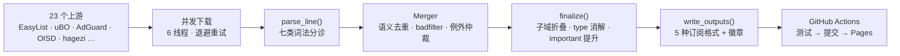

<div align="center">


# LJGZ · 广告过滤规则聚合

**23 个上游每日聚合 · 语义级去重 · 一份订阅覆盖全场景**


<br/>


**🌐 [在线订阅中心](https://wansheng8.github.io/LJGZ/)** — 点开即复制，无需读文档

</div>

---

## 订阅

| 场景 | 首选 (GitHub Pages) | 备选 (jsDelivr / CDN) | 备用 (raw) |
|---|---|---|---|
| 🧩 **浏览器扩展**<br><sub>uBlock Origin · AdGuard · Adblock Plus</sub> | [**all.txt**](https://wansheng8.github.io/LJGZ/all.txt)<br><sub>完整版 · 约 28MB</sub> | [statically 镜像](https://cdn.statically.io/gh/wansheng8/LJGZ/main/output/all.txt) | [all.txt](https://raw.githubusercontent.com/wansheng8/LJGZ/main/output/all.txt) |
| 🏠 **AdGuard Home**<br><sub>AdGuard Home · AdGuard DNS</sub> | [adguard.txt](https://wansheng8.github.io/LJGZ/adguard.txt) | [adguard.txt](https://cdn.jsdelivr.net/gh/wansheng8/LJGZ@main/output/adguard.txt) | [adguard.txt](https://raw.githubusercontent.com/wansheng8/LJGZ/main/output/adguard.txt) |
| 🕳 **Pi-hole / hosts**<br><sub>Pi-hole · SwitchHosts · 路由器</sub> | [hosts.txt](https://wansheng8.github.io/LJGZ/hosts.txt) | [hosts.txt](https://cdn.jsdelivr.net/gh/wansheng8/LJGZ@main/output/hosts.txt) | [hosts.txt](https://raw.githubusercontent.com/wansheng8/LJGZ/main/output/hosts.txt) |
| 📃 **纯域名列表**<br><sub>Cloudflare Gateway · NextDNS</sub> | [domains.txt](https://wansheng8.github.io/LJGZ/domains.txt) | [domains.txt](https://cdn.jsdelivr.net/gh/wansheng8/LJGZ@main/output/domains.txt) | [domains.txt](https://raw.githubusercontent.com/wansheng8/LJGZ/main/output/domains.txt) |
| ✅ **DNS 白名单**<br><sub>误拦截放行 · 例外列表</sub> | [whitelist.txt](https://wansheng8.github.io/LJGZ/whitelist.txt) | [whitelist.txt](https://cdn.jsdelivr.net/gh/wansheng8/LJGZ@main/output/whitelist.txt) | [whitelist.txt](https://raw.githubusercontent.com/wansheng8/LJGZ/main/output/whitelist.txt) |

> **浏览器扩展优先用 Pages 的 `all.txt`（唯一完整单文件）。** 完整版 28MB，超出 jsDelivr 单文件 20MB 上限（会返回 `Failed to fetch`），备选改用 statically 单文件镜像。

## 规模

| 指标 | 当前值 |
|---|---|
| 上游源 | **23 个**（全部成功才发布） |
| 拦截域名 | **约 55.8 万** |
| 规则总数 | **约 97.5 万**（分类去重后合计） |
| 全格式文件 | **约 28MB / 92 万行** |
| 更新时间 | **每日北京时间 08:00 / 20:00** |

覆盖广告、隐私追踪、恶意软件、钓鱼、挖矿、烦恼元素与中文专项。

## 工作原理



| 阶段 | 代码 | 职责 |
|---|---|---|
| ① 下载 | `fetch_text()` | urllib 零依赖，并行 6 路，指数退避；4xx 不重试 |
| ② 解析 | `parse_line()` | 一行分成 7 类：注释 / 预指令 / 表头 / 元素隐藏 / 纯域名 / 网络规则 / `@@` 例外 |
| ③ 合并 | `Merger` | 精确去重 + 修饰符排序后语义去重，`$badfilter` 失效，`@@` 例外保护 |
| ④ 仲裁 | `finalize()` | 子域折叠、同域 type 规则消解、`$important` 提升、DNS 能力筛选 |
| ⑤ 输出 | `write_outputs()` | 5 种格式、stats.json、徽章 SVG |
| ⑥ 发布 | `update.yml` | 145 项测试 → 合并 → 无变化跳过 → commit/push → 部署 Pages |

## 产物

| 文件 | 格式 | 适用 | 说明 |
|---|---|---|---|
| `all.txt` | ABP / uBO / AdGuard | 浏览器扩展 | 全语法完整版，**不做域名截断** |
| `adguard.txt` | AdGuard Home | DNS 服务器 | 子域折叠 + `$dnsrewrite` + 白名单 |
| `hosts.txt` | hosts | Pi-hole / 路由器 | `0.0.0.0 domain`，精确匹配含子域 |
| `domains.txt` | 纯域名 | Cloudflare / NextDNS | 一行一域，排序去重 |
| `whitelist.txt` | `@@` 例外 | 误拦截放行 | 与拦截列表配合订阅 |
| `stats.json` / `badge-*.svg` | 数据 | 站点 / README | 每次运行自动刷新，数字与最新结果一致 |

## 引擎特性

- **全语法识别** — ABP / uBO / AdGuard 网络规则、`##` 元素隐藏、`##+js()` 脚本注入、`@@` 例外、`$dnsrewrite`、hosts 式、Pi-hole 正则 `(^|\.)ad\.com$`、纯域名
- **语义等价归并** — `||d^` ≡ `d` ≡ `0.0.0.0 d` ≡ `*.d` ≡ Pi-hole 正则 → 一条；修饰符顺序无关，大小写 / FQDN 尾点归一
- **智能仲裁** — `$badfilter` 失效、`@@` 例外保护 DNS 输出、`$important` 压过普通例外、子域折叠、同域 type 规则消解
- **格式分诊** — 浏览器专用规则不污染 DNS/hosts 输出；localhost、`.arpa`、本机 IP 自动清除
- **零依赖** — 纯 stdlib 单文件，`python merge_filters.py` 即跑

<details>
<summary><b>🔬 合并 / 去重算法细节</b></summary>

1. **精确去重** — 文本相同的行只保留一条
2. **语义等价归并** — 同一域名的 5 种写法归并为一条
3. **修饰符规范化** — `$script,image` ≡ `$image,script`
4. **badfilter** — 命中 `$badfilter` 的规则从全部输出剔除
5. **例外保护** — DNS 相关 `@@` 例外：域名移出 DNS 输出、进白名单；`$important` 拦截可压过普通例外
6. **裸例外清理** — 无修饰符的 `@@||d^` 会架空整域拦截，直接丢弃
7. **子域折叠** — 父域已拦截时折叠子域；被折叠的 `$important` 子域会把优先级提升到父域
8. **同域 type 消解** — 已有 `||d^` 时，`||d^$script` 等纯类型窄规则删除（拦截结果不变，省体积）
9. **DNS 能力筛选** — AdGuard Home 不支持的修饰符规则不进 DNS 输出
10. **本机条目清除** — localhost、`*.arpa`、广播地址全部剔除

</details>

<details>
<summary><b>🚀 自动更新与部署</b></summary>

- 工作流：`.github/workflows/update.yml`（cron `0 0,12 * * *` UTC = 北京 08:00 / 20:00，`TZ=Asia/Shanghai`）
- 流程：145 项测试 → 下载 23 源 → 合并 → 无变化跳过提交，有变化自动 commit + push → 部署 Pages
- 另有两个纯清理 cron（06:00 / 18:00 UTC），只删旧 Actions 历史，保留最新 3 条
- 输出头部含 `! Last Modified: ... (北京时间 UTC+8)` 与 `! Expires: 12 hours`
- 徽章 SVG 由引擎每次运行重新生成，数字始终与最新合并一致

</details>

## 项目结构

```
merge_filters.py               # 核心引擎: 解析 → 合并 → 下载 → 输出 → 徽章 → CLI
config.json                    # 上游列表配置 (DIY 入口)
docs/index.html                # 在线订阅中心 (GitHub Pages)
docs/logo.svg                  # Logo
tests/                         # 145 项测试, 全部无网络
  test_parsing.py              #   词法分类
  test_merging.py              #   合并 / 去重 / 仲裁
  test_browser_profile.py      #   全格式完整性
  test_fetch_io.py             #   下载与重试
  test_badges.py               #   徽章生成
  test_e2e.py                  #   端到端
  test_adblock_tester.py       #   adblock-tester 回归
  test_safe_tracking_domains.py#   追踪域安全边界
  test_bare_exception_arbitration.py
.github/workflows/update.yml   # 每日更新 + Pages 部署
output/                        # 订阅文件 (CI 自动重新生成)
```

## DIY

```bash
git clone https://github.com/wansheng8/LJGZ.git
cd LJGZ

python merge_filters.py --test              # 冒烟自检
python -m unittest discover -s tests         # 145 项测试
python merge_filters.py                      # 下载合并 → ./output/
```

增删上游只需编辑 `config.json`（任何 ABP 兼容列表均可）：

```json
{ "name": "我的列表", "url": "https://example.com/filter.txt", "enabled": true }
```

`extra_rules` 可补充上游未覆盖的规则，最后合入、优先级最高。Fork 后工作流自动生效，产出你自己的订阅。

## 常见问题

<details>
<summary><b>订阅后规则数明显偏少 / 不拦截？</b></summary>

先确认用的是 GitHub Pages 的 `all.txt`。jsDelivr 超 20MB 会返回 `Failed to fetch`，此时改用 statically 镜像。旧版订阅需在扩展里手动「立即更新」才会拉取新内容。

</details>

<details>
<summary><b>为什么 `all.txt` 有 28MB？</b></summary>

全格式包含全部域名（约 55.8 万，子域折叠后约 50 万条）、网络规则、元素隐藏与例外，且不再做域名截断。首次导入较慢，之后按 `! Expires: 12 hours` 增量检查。

</details>

<details>
<summary><b>为什么 hosts / domains 和 all.txt 的数量不同？</b></summary>

`all.txt` 会做子域折叠（父域已拦则子域省略）与同域 type 规则消解；hosts / domains 保留精确子域条目。

</details>

---

<div align="center">

**⭐ 觉得有用请给个 Star！**

本项目仅做聚合与去重，不改变规则语义 · 上游列表版权归各作者，许可证以各列表头部声明为准

</div>
